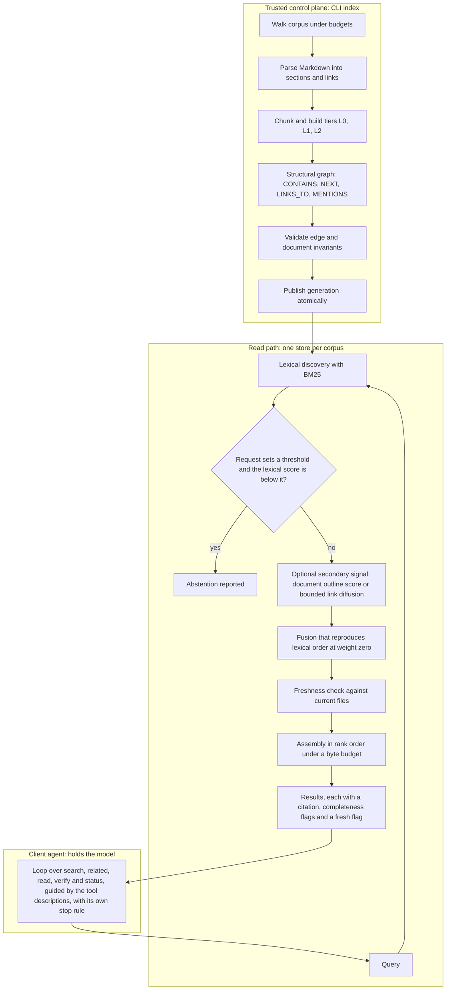

# Graph RAG 2026: summary and ideal architecture for OntoDoc

Date: 2026-11-15

Revision: 2. A second review checked every citation against the review file, re-read the cited source in the working tree and challenged the design. [Review record](#review-record) lists what changed.

Status: proposal at idea level. It approves no feature, changes no task status and reports no new measurement. An ADR and a plan task decide what is built (`AGENTS.md`, Donor Code).

Source: the per-paper review of 271 arXiv papers in [arxiv-graphrag-2026-review.md](arxiv-graphrag-2026-review.md). Numbers in square brackets are entry numbers in that file. Every paper result quoted here is the authors' claim.

Scope assumption: the request was "summary it and consolidate to ideal architecture". This document reads "ideal" as the best design the reviewed papers support for a service bound by OntoDoc's rules: no LLM, embedding or outbound network on the retrieval path, deterministic and bounded work, and five read-only tools. [Without OntoDoc's constraints](#without-ontodocs-constraints) lists what a system free of those rules would add.

## Conclusion

1. OntoDoc follows a minority direction in the 2026 papers. 31 of 271 entries use an LLM in neither stage, and that group includes embedding methods, curated graphs and tangential papers. No reviewed paper that builds its graph from document structure and links is model-free end to end: [19] ranks densely, [129] embeds chunks, and [80, 184, 200] call an LLM during retrieval. The closest design is [149], where an agent holds the model and works through a document tree with BM25 search. A client agent uses OntoDoc's tools the same way.
2. The comparisons are mixed. Plain or lexical retrieval wins or ties on single-hop questions, at scale and on cost [66, 145, 149, 177, 178]. Graph retrieval keeps an advantage on multi-hop questions and on answer-citation F1 [69, 110, 182], and a version-aware citation graph answered 19 of 20 questions against 5 of 20 for vector retrieval [80]. OntoDoc's exploratory dev data shows both fused modes ahead of the lexical ranker on net.
3. One next step is supported: diagnose the dev gains and losses of both fused modes together and take a census of the walk graph, with no code change. This revision selects no fusion rule and no hub control. A lexical-head floor is listed as one candidate among five, because each pinned result removes one fused entrant and both fused modes recover more pairs than they displace.
4. Three properties of the service bear on every ranking discussion. Score abstention is opt-in per request. The document signal scores a capped outline of each document. `search` returns chunks, while the dev figures count sections.

## What the 271 papers say

| Measure | Count |
|---|---|
| Papers reviewed (tier A) | 271 |
| Method papers | 129 |
| Application papers | 62 |
| System papers | 22 |
| Benchmarks | 21 |
| Attack or defence | 9 |
| Tangential | 26 |
| Surveys | 2 |
| Call an LLM when the index is built | 146 yes, 63 no, 62 not stated or not applicable |
| Call an LLM during retrieval | 151 yes, 90 no, 30 not stated or not applicable |
| Use an LLM in neither stage | 31 |
| Novelty 3 (rethinks the pipeline) | 27 |

The review recorded LLM use and did not record embedding use, so the number of entries that are model-free end to end is unknown. It is at most 31.

Four shifts recur against the 2024-2025 design of an LLM-extracted entity graph with community summaries:

1. **Cheaper graphs.** The graph comes from document structure and links [19, 80, 129, 184, 200], from a parser [8, 218, 225], from co-occurrence of tokens, sentences or training passages [150, 186, 215, 238], or from passage similarity [229]. Most of these methods still need an embedding model.
2. **The graph navigates and the source text is the evidence.** Extraction drops qualifiers and negation, so several papers use the graph only to find passages [17, 36, 137, 170, 214, 226].
3. **Control moves to the query.** Routers, per-query policies and agents decide whether and how to use the graph [23, 67, 156, 223, 235, 266].
4. **The claims are being tested.** The results point in both directions:

| Direction | Result | Entry |
|---|---|---|
| Against a graph pipeline | BM25 leads at 601M tokens, and graph systems finish fewer corpus sizes | 178 |
| Against a graph pipeline | An agent browsing the document tree with BM25 reaches 81.5% against 49.5% for GraphRAG | 149 |
| Against a graph pipeline | Well-prepared plain RAG reaches 94.1% against 82% | 66 |
| Against a graph pipeline | Under exact tuple matching GraphRAG recalls 3.8% in global mode and 0.9% in local mode | 126 |
| Against a graph pipeline | A graph baseline reaches macro-F1 0.663 against 0.830 for a flat LLM on 101 pairs | 161 |
| Against a heavier graph pipeline, for one bounded hop | Documents plus one-hop relations reach Hit@1 0.6972 against 0.6422 for a hybrid graph pipeline | 145 |
| Neutral | GraphRAG and a vector baseline are statistically indistinguishable overall | 177 |
| Neutral | Neighbour expansion was ineffective in one study and neutral in another | 19, 243 |
| For the graph | Graph backends keep an advantage on multi-hop tasks under one agent protocol and matched budgets | 69 |
| For the graph | GraphRAG wins every MuSiQue stratum on answer-citation F1, while its context precision is 0.12 to 0.23 | 110, 182 |
| For the graph | A version-aware citation graph answers 19 of 20 questions against 5 of 20 for vector RAG, on 20 questions with keyword-overlap scoring | 80 |

The evidence is weak throughout. At least 26 entries score answers with an LLM judge, many test sets hold 10 to 50 questions, many benchmarks are the authors' own, and 21 entries have headline numbers that were not in the pages read. Nothing was reproduced.

## Design principles

The Basis column says where each principle comes from: the papers, an OntoDoc rule that already binds the service, or this document's inference.

| # | Principle | Support | Basis |
|---|---|---|---|
| P1 | The lexical ranker is the baseline every other signal must beat | BM25 leads at the largest corpus size [178]. An agent with BM25 over the document tree beats GraphRAG [149]. Plain RAG beats GraphRAG in [66] and ties it in [177] | Papers |
| P2 | Build the graph from what the documents state | Structure, hyperlinks and parser output replace extraction [8, 19, 80, 129, 184, 200, 218, 225]. In [8] indexing took 2.81 s against 200.14 s for the LLM-built graph. These systems still use an embedding model or an LLM in another step | Papers |
| P3 | The graph locates and the source text answers | A graph is a lossy index, so the reader sees source passages and never triples [17, 36, 137, 170, 205, 214, 226] | Papers |
| P4 | Keep discovery separate from ranking, and combine signals whose scales differ by rank | A composite score with many terms made results worse [84]. Reciprocal rank fusion needs no score normalization and limits how far one signal can dominate [228], and two hybrid systems fuse this way [154, 176]. None of them fuses BM25 with a link walk, and [86] compares a learned score with an LLM's ordinal output, so applying the point to OntoDoc's blend is an inference | Papers and inference |
| P5 | Bound and damp the walk | No propagation from high-degree type nodes [122]. Edges filtered by endpoint structure before PageRank [215]. A degree penalty and one diffusion step [229]. Three fixed rounds [151]. Hub penalties during expansion [222]. Propagation only from confident matches [57], and escalation only when local evidence is insufficient [17]. All of these act on entity graphs or passage graphs built with embeddings | Papers |
| P6 | Protect the best evidence under a budget and report completeness | Seed-local text survives truncation when it is rendered first [218]. Context precision barely matters while the answer path stays in [221]. [163] reports evidence completeness with every bounded operator, and `AGENTS.md` makes a hit cap an explicit flag | Papers and OntoDoc rule |
| P7 | Admit evidence only through a citation check | A quoted span must match the source, and retrieval scores never enter the evidence [200, 203, 216, 261] | Papers and OntoDoc rule |
| P8 | Query-side control belongs to the caller that holds the model | Agentic search lifts dense RAG under one protocol [69], and an agent with simple tools beat a graph pipeline [149]. Placing that control in the client is this document's inference | Inference |
| P9 | Derived index state is an attack surface | Edits to summaries, hierarchy edges and scores affect many queries without changing a source document, and bridge and poisoning attacks target the graph [52, 71, 239, 247] | Papers |
| P10 | Compare at equal budgets and keep graph signal out of the labels | Equal candidate budgets isolate the retrieval effect [219]. The label rule is OntoDoc's (`AGENTS.md`, Evaluation Integrity). [106] and [192] show only that graph features can leak the prediction target, through edges to future papers and through a paper's own citations | Papers and OntoDoc rule |

## Ideal architecture

The design has three parts with one rule each. The control plane builds every derived structure deterministically from trusted input and validates it before publication. The read path treats BM25 as the baseline that every other signal must reproduce at weight zero. The client agent owns every decision that needs a model, so the tool descriptions it reads are part of the design.

Most layers restate rules that already bind OntoDoc. The papers add support for them and add little new design.

| Layer | Rule | Basis |
|---|---|---|
| 1. Index and graph construction | Nodes are the sections and chunks the parser produces. Edges record only what an author wrote: containment, reading order and resolved links. An unresolved link is a diagnostic and never an edge. The builder runs in the trusted CLI, sorts and deduplicates its output, and refuses publication when an edge or document invariant fails | Papers for the structure-and-links graph [19, 129, 200]. OntoDoc rule for validation (service ADR revision 19) |
| 2. Lexical baseline | BM25 over heading path and chunk text is the default ranker and the candidate generator. When a request sets a threshold, abstention is decided on lexical evidence before any fusion, so a secondary signal cannot turn an unanswerable query into a confident result | Papers for the baseline [178]. OntoDoc rule for abstention; [170] supports only the general point that refusal should rest on source text |
| 3. Secondary signals | Each is optional and computed from stored structure. A document outline score raises chunks of a document whose headings and opening sentences match the query. A link diffusion spreads lexical seed mass over link and reading-order edges | The outline score is OntoDoc's own design, and no reviewed paper tests it. Papers for seeded diffusion [17, 215] |
| 4. Fusion | Discovery builds one candidate pool, and ranking orders it with as few combined terms as possible. Lexical order is reproduced exactly at weight zero under a fixed tie rule | Papers for few terms [84]. OntoDoc rule for zero-weight reproduction (service ADR decision item 6). Fusing by rank is a candidate that rests on inference (P4) |
| 5. Evidence assembly | Results are rendered in rank order under a byte budget. The top-ranked evidence keeps its text first, a result keeps its citation when its text is withheld, and every bounded operator reports what it left out | Papers [218, 221]. OntoDoc rule (service ADR revision 18) |
| 6. Citation and verification | Every returned unit carries a citation that the service can check against current file bytes. Scores, graph paths and explain output are discovery data and never evidence. A repeated passage keeps its own span | Papers [200, 203, 216, 261]. OntoDoc rule |
| 7. Query-side control | Routing, decomposition, escalation from search to neighbours, and the stop rule belong to the client agent. The service gives it small, deterministic and composable operations and describes them accurately | Inference from [69, 149]. The papers that put this control inside the retriever almost all use an LLM to do it [23, 67, 156, 223, 235, 266] |
| 8. Freshness | Every response says whether the index matches the current files. Reads serve the indexed snapshot, and verification checks current bytes | OntoDoc rule (service ADR decision item 9). No paper in the review covers it |
| 9. Security boundary | Indexing stays in the trusted control plane, corpus text is untrusted data, and derived structures are validated at publication and at load | OntoDoc rule. The papers describe the attacks [239, 247]. Two inferences: graph theft [12, 26, 119] falls outside the threat model while every service user may read every exposed corpus, and link-based ranking trusts the corpus authors, since a writer who can add links can promote a page in graph mode [52, 71] |
| 10. Evaluation | Compared arms get the same candidate budget. Labels never come from links or any other graph signal. Deterministic metrics decide, and model-judged labels stay exploratory. BM25 is always one of the arms. Retrieval quality is measured apart from answer quality, because the metric choice can reverse a ranking | Papers [110, 143, 178, 182, 219]. OntoDoc rule for labels |

Two deterministic additions to layer 1 appear in the papers and are left out. Explicit version edges such as `SUPERSEDES` [80, 195] apply only where documents declare versions, and Markdown has no standard markup for that. A token co-occurrence graph [150] needs no model at index time, but its headline numbers were not in the pages read, and in this document's judgement it mostly restates the word overlap BM25 already measures.

## OntoDoc against the ideal

Source references were checked by read-only explorers on 2026-11-15 against the working tree, which holds uncommitted work. The coordinator re-read `src/search/ppr.rs`, `src/search/fusion.rs`, the `search` function in `src/search/mod.rs` and the head of `src/graph.rs`.

| Layer | OntoDoc today | Gap or open question | Existing deferred item | Cost to close |
|---|---|---|---|---|
| 1. Graph construction | Four edge kinds (`EdgeKind`, `src/graph.rs:35`). `resolve` (`src/graph.rs:174`) ignores `://` and `mailto:` destinations, maps `.html` and `.htm` to an existing sibling Markdown file, reports a missing Markdown target as a diagnostic, and attaches a link to the first chunk of its target section or document. Invariants are checked by `validate_edges_and_documents` (`src/store.rs:333`). Schema 4 (`src/store.rs:38`) | Directory and extensionless links are ignored: 52 and 10 link events in the OntoIndex corpus, none in the Rust Book. How many unique edges a rule would add is unmeasured | C3 in `docs/DONOR_CANDIDATES_PLAN.md` | Schema bump, reindex of every store, a graph-mode ranking change |
| 2. Lexical baseline | BM25 with `K1` 1.2 and `B` 0.75 (`src/search/bm25.rs`). `tokenize` lowercases, splits identifiers and does no stemming (`src/search/tokenize.rs:9`). Heading path and chunk text are tokenized at one weight (`src/search/mod.rs:222`). Lexical is the default mode with `top_k` 10 (`src/cli.rs:243`). Score abstention runs before fusion and only when the request sets `threshold` (`src/cli.rs:260`, `abstention` in `src/search/mod.rs`) | A default request never abstains on score. With no lexical match it returns no results and no reason, while the `search` tool description promises "an abstention reason when nothing matches well enough" (`src/mcp.rs:429`) | C4, C5 for lexical variants; none for abstention | Tool description wording by a plan task. A default threshold would need a dev value and an ADR amendment |
| 3a. Document outline score | B3 scores each document's `pseudo_doc` with BM25 (`src/search/mod.rs:226`). `pseudo_document` in `src/tiers.rs` joins every heading with the first sentence of each section, capped at 16 KiB (`PSEUDO_DOC_CAP`). Every chunk of a document gets the same score | Body text past each first sentence does not count. Tied scores among chunks of one document are the normal case | None | None proposed |
| 3b. Link diffusion | PPR over a simple undirected graph of `LINKS_TO` and `NEXT` pairs (`src/search/mod.rs:251`), damping 0.85, tolerance 1e-9, at most 100 iterations, 10 seeds (`src/search/ppr.rs:12`). `ChunkGraph::new` collapses parallel edges and self-loops. The walk covers the whole graph, and scope masks its scores afterwards | Both edge kinds weigh the same, and reading order supplies at least 82% of the Rust Book pairs. The degree distribution over these two kinds is unmeasured | GR-3 in `docs/GRAPHRAG_REFERENCES_PLAN.md` | A census from stored artifacts. Any change is a new evaluation arm, then a fresh test split |
| 4. Fusion | `score = (1-w)·minmax(bm25) + w·minmax(secondary)` over a pool of B1's top max(50, `top_k`) plus PPR's top 50 in-scope chunks (`CANDIDATES`, `src/search/mod.rs:32`). Ties break by raw BM25, then chunk id (`fuse`, `src/search/fusion.rs:23`) | Scaled scores are blended. A `hier` result can hold a chunk with no query term. `hier` computes PPR and uses it only for pool membership. The selected alpha 0.5 is the top of the tuning grid `{0, 0.1, ..., 0.5}` | Decision 2 in `docs/ADR_DONOR_ADOPTION.md`, GR-5 | Diagnosis first; then at most one arm and a fresh test split |
| 5. Assembly | Tiers L0, L1, L2 in rank order under `budget_bytes` (`assemble`, `src/assemble.rs:46`). A result keeps its citation when its text is withheld (service ADR revision 18). Responses are bounded at 128 KiB (`MAX_RESPONSE_BYTES`, `src/cli.rs:25`) | `search` has `truncated` and no count of omitted results | `omitted` on `search` | One response field, by ADR amendment |
| 6. Citation | `verify` returns `Valid`, `Moved`, `Stale` or `Missing` (`CitationState`, `src/cite.rs:62`). Chunk and section neighbours carry citations (service ADR revision 17) | A link relation has no span of its own, and a code mention has no citation | GR-4 link spans | Schema 5 and a reindex |
| 7. Query control | Five tools: `search`, `read`, `related`, `verify`, `status` (`src/mcp.rs:429` to `520`). `related` (`src/cli.rs:991`) takes a chunk id and lists at most 100 neighbours in stored edge order with an `omitted` count. Outgoing `MENTIONS` and `CONTAINS` edges count toward the 100, and inbound `MENTIONS` are not listed. `ReadRequest` has only `id` (`src/mcp.rs:34`) | The server instructions (`get_info`, `src/mcp.rs:536`) name `search`, `read`, `related` and `verify`. They name neither the `graph` and `hier` modes nor `threshold`. Two of 1,370 Rust Book chunks exceed 100 neighbours | C6, `read` continuation | Wording by a plan task. Request fields need an ADR amendment |
| 8. Freshness | Every response carries `fresh`. In `App::search` the freshness check runs after ranking (`src/cli.rs:877`). `read` serves the snapshot and `verify` checks current bytes (service ADR decision item 9) | None found. Its cost per request was not measured | None | None |
| 9. Security | Invariants are validated at publish and load (service ADR revision 19). `App::index` publishes through `src/store.rs`. `serve-http` refuses a non-loopback address (`src/http.rs:232`). A search of `src/` outside `src/eval/` found no embedding, LLM or outbound HTTP client use | None found | None | None |
| 10. Evaluation | Closed system set B0 to B3, dev tuning only, and the one held-out attempt is consumed | No test split is available for a new claim. Dev labels are model-judged. Evaluation ranks sections while the service returns chunks | Evaluation arm in `docs/DONOR_CANDIDATES_PLAN.md` | Fresh pre-registered split with human labels |

### Properties that follow from the code

None of these was observed on a query. Each follows from the functions named.

1. **Scale.** With `w` 0.5, a pool member with the lowest BM25 score and the highest secondary score gets 0.5, and a member with scaled BM25 0.6 and the lowest secondary score gets 0.3. Min-max scaling gives the top secondary score the value 1 whatever its absolute strength. The minimum is taken over the pool, so one zero-BM25 entrant moves the scaled BM25 of every other member.
2. **Pool.** `search` in `src/search/mod.rs` computes PPR and adds its top 50 in-scope chunks to the pool in both fused modes. In `hier` mode such a chunk can share no query term and still score `beta × minmax(outline score)`. Whether any of B3's 32 displacements arose this way is unknown.
3. **Unit.** `App::search` returns one result per ranked chunk and never merges chunks of one section. Evaluation fetches 50 chunks (`FETCH`, `src/eval/run.rs:32`) and keeps each section's first occurrence (`rank_sections`). The Rust Book store holds 1,370 chunks in 547 sections, about 2.5 chunks per section, so ten returned chunks can cover fewer than ten sections while the dev figures count ten sections.
4. **Work.** Both fused modes run PPR over the whole chunk graph for up to 100 iterations, and the freshness check adds corpus work to every response. No latency was measured, so cost separates no option below.
5. **Edge mix.** `NEXT` joins consecutive chunks of one document, which gives at least 1,258 pairs for the Rust Book's 1,370 chunks in 112 documents (`docs/ONTOINDEX_IDEAS_PLAN.md:607`). The store holds 276 `LINKS_TO` edges. Reading order is therefore at least 82% of the walk graph, and graph mode on that corpus mostly spreads score to adjacent chunks. The OntoIndex corpus has 44 `LINKS_TO` edges.
6. **Sparse graphs.** With no seed, PPR returns zero for every chunk. Mass on a chunk with no neighbour returns to the seeds. A corpus with no links leaves only reading-order pairs.

### Dev evidence

The figures are quoted from `docs/ADR_DONOR_ADOPTION.md`. They rest on model-judged labels and count relevant query-section pairs, 414 in total.

| System | Missed from top 10 | Displaced from B1's top 10 | Recovered | Net against B1 |
|---|---|---|---|---|
| B1 lexical | 99 (78 `truncated`, 21 `lexical_miss`) | n/a | n/a | n/a |
| B2 link diffusion, alpha 0.5 | 88 | 15, in 11 queries | 26 | +11 |
| B3 outline score, beta 0.3 | 69 | 32, in 24 queries | 62 | +30 |

The table shows that under these labels both fused modes gain more pairs than they lose, and that the outline score moves more pairs than the link diffusion in both directions. It cannot show the cause of any gain or loss, whether an entrant matched a query term, how the chunk results a client receives compare, or anything about held-out queries. It supports no quality claim.

## Options

Each option is a sketch for an ADR task. None was implemented or measured, and this document selects none.

### Fusion

| Option | Rule | Reproduces B1 at weight 0 | Open points |
|---|---|---|---|
| A. Keep the min-max blend | Current behaviour | Yes by reading `fuse`. `zero_weight_fusion_reproduces_b1_exactly` (`src/search/mod.rs:765`) covers `top_k` 1, 3 and 10 on one fixture | None |
| E. Fuse `hier` over B1's candidates only | The outline score reorders B1's top max(50, `top_k`), and `hier` runs no PPR | Yes | Changes service ADR decision item 6, which gives B3 "the same candidate pool as B2". Changes the scaled BM25 of every query whose pool held a zero-BM25 entrant |
| B. Weighted reciprocal rank | `(1-w)/(k + rank_bm25) + w/(k + rank_secondary)` | Only if the zero-BM25 filter and B1's tie order are kept | A rank rule for tied secondary scores, which are the normal case for the outline score. A rule for zero scores. A value for `k`. Large BM25 margins are flattened. Decision 2 is deferred and reopened for diagnosis only |
| C. Lexical-head quota | B1's first `q` results are guaranteed a place, with `q` below `top_k`, and the other slots follow fused order | Yes | Each guaranteed place removes one fused entrant, so the quota caps recoveries as well as displacements. With 62 recovered against 32 displaced for B3, a net gain cannot be assumed. The unit, chunk or section, and the output order are undefined. At `q` equal to `top_k` the result is B1 |
| D. Confidence gate | Apply the secondary signal only when a lexical confidence test passes | Yes, if a closed gate returns B1 | An untested heuristic. [57] propagates only from confident matches and [17] escalates when local evidence is insufficient, which point in opposite directions. Needs a threshold |

At most one candidate should advance, chosen by the cause a diagnosis names:

| Diagnosed cause | Candidate |
|---|---|
| Displaced pairs lose to entrants with no query term | E |
| Displaced pairs lose to other chunks of the same document or section | Section handling in the result list, or heading weight (C5) |
| Displaced pairs lose where one secondary score dominates after scaling | B |
| Losses sit in the lowest fused entrants and recoveries sit higher | C |
| No clear cause | A |

### Link diffusion

The edge-kind question comes before hub control. `NEXT` gives a chunk at most two neighbours, and a link lands on the first chunk of its target, so only the first chunks of often-linked targets can have a high degree. The recorded maximum of 132 neighbours counts code mentions and containment, which never enter the walk. PPR already divides each chunk's mass by its degree. Hub control therefore has no measured target in OntoDoc, and none of the controls below advances.

| Control | Rule in the paper | Entry | Caution |
|---|---|---|---|
| H1 | Never start propagation from a high-degree type node | 122 | Type nodes of an entity graph |
| H2a | Filter edges by the isoperimetric profile of their endpoints before PageRank | 215 | Dense seeds; edges from training-instance co-occurrence |
| H2b | Penalise degree in the edge weight and run one diffusion step | 229 | Edge weights come from embeddings |
| H2c | Weight entity-passage links by term frequency | 140 | Discounts incidental mentions; unrelated to degree |
| H3 | Run three fixed rounds, gated by cosine similarity to the query | 151 | Bounds depth and does not penalise hubs |

The papers also report that expansion can add nothing: neighbour expansion was ineffective in [19] and neutral in [243].

### Signals outside the graph

These come from classical information retrieval. The review file has no source for them, and they are listed because a diagnosis may point at lexical causes.

| Signal | State in OntoDoc | Cost |
|---|---|---|
| Heading weight in BM25 | Headings and text share one weight. Deferred as C5 | An in-memory repeat of heading tokens; the value 1 reproduces B1 |
| Link anchor text indexed on the target | In no code and no plan | Schema change and reindex |
| Exact phrase or term proximity | Postings hold a document and a term frequency (`src/search/bm25.rs:14`). Exact phrase is deferred as C5; proximity is in no plan | Stored positions cost memory |
| `MENTIONS` as a ranking signal | Stored and listed by `related`; unused in ranking | A new evaluation arm |
| Link direction | The walk graph is undirected (service ADR decision item 6) | ADR change and a new arm |
| Pseudo-relevance feedback | Absent | Not recommended: a second retrieval pass that can drift from the query |

## Without OntoDoc's constraints

This section is a synthesis by the coordinator. No paper proposes this exact combination.

| Component | What it is meant to add | Entries | Why OntoDoc excludes it |
|---|---|---|---|
| Dense retrieval beside BM25 | Paraphrase matching | 28, 132, 228 | No embedding on the retrieval path; `docs/ADR_DONOR_ADOPTION.md` answers "not now" and lists reopen conditions |
| Similarity edges between passages | A graph with no extraction | 132, 219, 229 | Needs embeddings; permanent similarity edges cause drift [55] |
| LLM extraction of entities, relations and community summaries | Corpus-wide and multi-hop questions [69, 182] | Most of the 146 entries that call an LLM at index time | No LLM and no determinism. One cost audit estimates GraphRAG indexing at $19.49 to $38.99 and quotes $2.30 to $24.94 per 5.64 MB corpus from KET-RAG [199], and recall was low under exact matching [126] |
| Router or policy inside the retriever | Per-query choice of strategy | 23, 67, 156, 223, 235, 266 | Needs a model; the client agent holds it |
| Learned retriever (GNN, graph foundation model, reinforcement learning) | Task-specific ranking | 6, 13, 49, 62, 78 | Training data, model weights, no determinism guarantee |
| Graph memory that the agent edits | Reuse of earlier reasoning | 24, 83, 167 | The service is read-only and indexing stays in the control plane |

A system free of the constraints would keep every layer above and add two things: a dense signal fused by rank with the lexical one, and an agent loop that decides when to stop. It would add an LLM-built entity graph only for multi-hop questions on a corpus small enough to index affordably, since multi-hop is the setting where the comparisons still favour it [69, 182] and graph systems finished fewer corpus sizes in [178].

## What not to build

| Do not build | Reason | Entries |
|---|---|---|
| An entity or community graph | Low recall under exact matching, no reliable gain over plain retrieval and high indexing cost. The same graphs keep a multi-hop and answer-citation advantage [69, 110, 182], which OntoDoc's rules put out of reach | 126, 161, 177, 199 |
| Unbounded or multi-hop neighbour expansion inside `search` | Expansion was ineffective or neutral, and one hop was enough | 19, 145, 243 |
| A composite score with many terms | It made results worse than plain similarity | 84 |
| Several interacting ranking changes in one round | Each needs its own arm, and no test split exists for even one claim | OntoDoc rule |
| Paths as the returned unit | Adding paths to the returned nodes lowered accuracy | 93 |
| Stored similarity edges | Permanent densification causes drift | 55 |
| Context trimming for precision | Precision had no measured effect while the answer path stayed in | 221 |
| Labels or qrels derived from links | `AGENTS.md` forbids it, because the graph signal would leak into the labels. [106, 192] show a related leak through graph features | OntoDoc rule |
| Hub control ahead of a census | No high-degree chunk has been measured in the walk graph | Inference |
| A token co-occurrence graph ahead of evidence | Headline numbers were not in the pages read | 150 |

## Next steps

The four tracks are independent. None is approved by this document, and no task is created or reopened by it. Changing nothing is a valid outcome of every track.

| Track | Work | Needs | Existing item |
|---|---|---|---|
| A. Diagnosis, no code change | For B2 and B3 on dev, classify displaced and recovered pairs together. For each entrant, record its lexical standing from the existing `search --explain` fields `bm25` and `bm25_rank` (`Components`, `src/search/mod.rs:161`). From stored artifacts, count degree by edge kind over `LINKS_TO` and `NEXT`, and count how often several chunks of one section share a top 10 | An owner-approved descriptive protocol. Dev split only; no held-out query or label is loaded | GR-5, GR-3 |
| B. One ranking candidate, then a claim | The single candidate that the diagnosed cause names, as a dev-only arm that reproduces B1 at weight zero | A named cause from track A. A service-ADR task, a change to the closed B0 to B3 system set and a new preparation pin. Probably a pool extension, because the score gate refuses a system below 0.95 judged@10 (`MIN_JUDGED`, `src/eval/gates.rs:24`). A claim then needs a fresh pre-registered test split with human labels | Decision 2, evaluation arm |
| C. Client contract | Bring the `search` tool description and the server instructions in line with behaviour: abstention is opt-in, and the `graph` and `hier` modes exist. Later, a kind filter or offset on `related`, a continuation on `read`, and `omitted` on `search` | Wording needs a plan task. Request and response fields need a named client workflow and an ADR amendment | C6 and the deferred rows of `docs/DONOR_CANDIDATES_PLAN.md` |
| D. Schema | Directory and extensionless link resolution; link spans | A count of unique edges gained, a schema bump and a reindex of every store. A resolver change alters `graph` mode, so it lands before any configuration is frozen for track B | C3, GR-4 |

## Review record

The second review used seven GPT explorers for citation and source checks and one for a design challenge. It checked 179 claim-and-entry pairs against the review file: 159 held, 16 were partly supported, 4 were unsupported and none said the opposite. Every count and quoted figure matched.

### Corrections

| Revision 1 said | Evidence | Revision 2 |
|---|---|---|
| Abstention is a gate before fusion | `threshold` is optional and "disabled when absent" (`src/cli.rs:260`); `Params::new` sets it to `None` (`src/search/mod.rs:144`); `.memory-bank/ADR_ONTODOC_SERVICE.md:1137` | Abstention is opt-in per request, and the tool description gap is listed |
| The document signal matches the whole document | `pseudo_document` in `src/tiers.rs` joins headings and first sentences under a 16 KiB cap | "Document outline score" |
| The 2026 papers converge on OntoDoc's design | 32 of 271 entries use no LLM, and every structure-and-links example uses an embedding model or an LLM somewhere | A minority direction; the model-free share is unknown |
| [151] supports one or two fixed steps | [151] runs three rounds gated by cosine similarity | Row H3 corrected |
| [140] weights edges by endpoint degree | [140] weights entity-passage links by term frequency | Row H2c |
| [106, 192] support the rule against link-derived labels | [106] excludes edges to future papers; [192] removes own-citation leakage from features | The rule is attributed to `AGENTS.md` |
| [239] supports refusing publication | [239] is an attack paper | The rule is attributed to service ADR revision 19 |
| The document signal resembles [205, 244] | [205] merges similar video chunks; [244] restructures sections with metadata | Analogy removed |
| [215] builds edges from passage similarity | Its edges come from training-instance co-occurrence | Moved in both files |
| 148 entries extract entities | 148 is the count of entries that call an LLM at index time | Reworded |
| A confidence gate rests on [17, 57] | The two papers point in opposite directions | Option D is an untested heuristic |
| All fusion options cost a pass over at most 100 candidates | PPR runs over the whole graph in both fused modes, and freshness adds work per response | No cost claim; latency is unmeasured |
| No gap in layers 2, 3a and 8 | A `hier` result can hold a chunk with no query term; a default request never abstains on score | Gaps listed |
| [163] supports completeness reporting in general | Revision 2 narrowed this to temporal operators; the 2026-11-15 audit of the review restored the paper's scope, every bounded operator | P6 states the paper's scope |
| [86] shows raw scores are incommensurable | [86] compares a learned score with an LLM's ordinal output | Marked as inference in P4 |
| B1's 78 misses were found within depth 50 | The source labels them `truncated` | Source label quoted |

### Design changes

| Revision 1 | Problem | Revision 2 |
|---|---|---|
| Picked a lexical-head floor | B3 recovers 62 pairs and displaces 32; each pinned result removes one fused entrant | No option selected |
| Left the floor undefined | No quota size, unit or output order | Defined as a quota, with its open points |
| Rank fusion with no tie rule | Every chunk of a document shares one outline score | Open points listed |
| "Reproduces B1 at weight 0" stated for every option | True only under conditions | Conditions stated per option |
| Proposed hub control | The walk graph has no measured hub | Not advanced; census first |
| A six-stage ladder | The stages do not depend on each other in that order | Four independent tracks |
| Nine layers presented as the papers' design | Most layers restate `AGENTS.md` and the service ADR | A Basis column on principles and layers |
| Four fusion options and three hub controls in play | Too many arms for no test split | At most one candidate per diagnosed cause |
| Negative results led the summary | Positive graph results [69, 80, 110, 182] carry the same weight | One table with both directions |

### Added

The unit mismatch between chunk results and section evaluation; the edge mix of the walk graph; sparse and empty graphs; freshness as a layer; the client-facing tool descriptions; six signals outside the graph; option E; the alpha value at the edge of its grid; PPR computed in `hier` mode for pool membership only; scope applied after the walk; the neighbour order and counting rules of `related`.

### What held

The source facts in the comparison table, apart from the corrections above; the pool rule and the zero-BM25 entrant in `hier` results; every count and quoted paper figure; the dev figures; the absence of approval language, held-out reuse and link-derived labels; and "diagnose first", now widened to gains as well as losses.

## Limits

- Paper results are the authors' claims, read from the first 10 to 16 pages by sub-agents. Nothing was reproduced, and tier B (158 papers) is not reviewed.
- The second review checked citations against the review file and did not reopen the PDFs. A reading error in the review file carries over.
- The mapping of entries to principles is the coordinator's reading. The lists are examples and are not complete.
- The six signals outside the graph have no source in the review file.
- Source references were read on 2026-11-15 in a working tree with uncommitted work, so line numbers can move.
- The properties derived from code were not observed on a query. The edge-mix figure is computed from counts recorded in `docs/ONTOINDEX_IDEAS_PLAN.md` and `docs/ADR_DONOR_ADOPTION.md`; no store was read for it.
- Dev figures are quoted and were not recomputed. Their labels are model-judged, so they guide diagnosis and support no quality claim.
- The options are sketches for an ADR task. None was implemented or measured.
- No build, test, lint or benchmark ran for this document.
